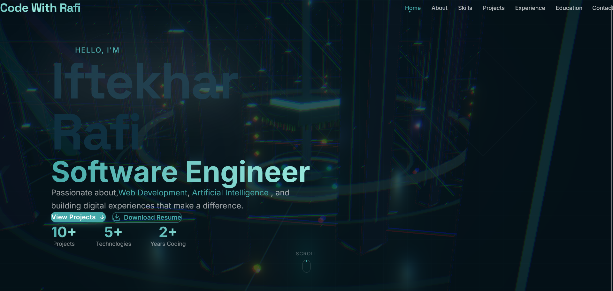
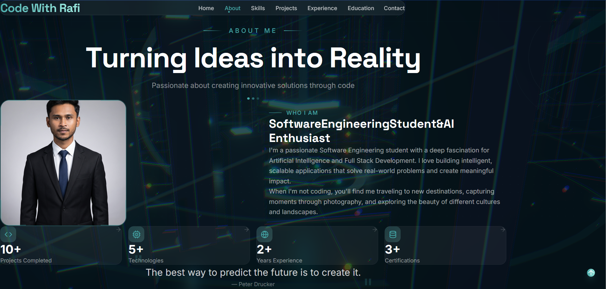
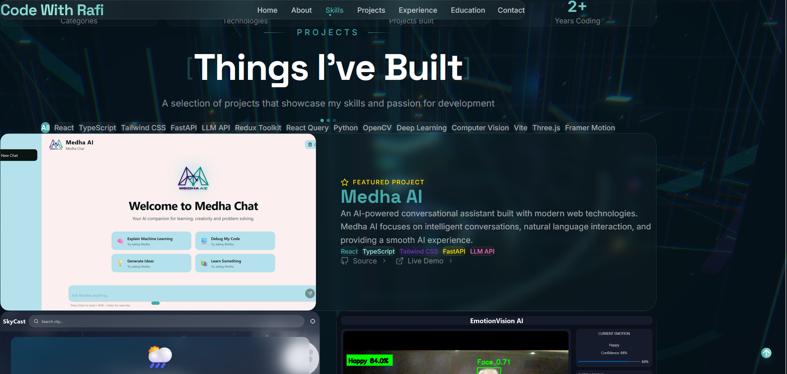

<div align="center">

# Rafi Portfolio

### Modern Developer Portfolio built with React, Three.js & Framer Motion

Showcasing my software engineering journey, projects, skills, and experience through an immersive and interactive web experience.




</div>

---

## Live Demo

> **Website:**

```
https://portfolio-coral-two-g6bednee2s.vercel.app/
```

---

# Features

- Modern Premium UI/UX
- Interactive 3D Background using React Three Fiber
- Smooth Animations with Framer Motion
- Fully Responsive Design
- Beautiful Glassmorphism Cards
- Clean Component Architecture
- Professional Project Showcase
- Resume Download
- Contact Section
- Optimized Production Build
- Built with Modern React Ecosystem

---

# Tech Stack

## Frontend

- React 19
- Vite
- JavaScript (ES6+)

## Styling

- Tailwind CSS v4
- CSS Modules
- Custom CSS Animations

## Animations

- Framer Motion

## 3D Graphics

- Three.js
- React Three Fiber
- Drei

## Icons

- Lucide React

## Fonts

- Inter
- Space Grotesk

---

# Project Structure

```
src
│
├── assets
│   ├── images
│   └── resume
│
├── components
│   ├── cards
│   ├── common
│   ├── layout
│   ├── three
│   └── ui
│
├── constants
│
├── hooks
│
├── layouts
│
├── sections
│
├── styles
│
├── App.jsx
│
└── main.jsx
```

---

# Sections

- Hero
- About Me
- Skills
- Projects
- Professional Journey
- Education
- Contact
- Footer

---

# Interactive 3D Scene

The portfolio includes a custom-built Three.js environment featuring:

- Floating Processor Core
- Neon Circuit Floor
- Tech City
- Data Streams
- Circuit Connections
- Animated Particles
- Dynamic Camera Movement
- Lighting Effects

Built using:

- React Three Fiber
- Drei
- Three.js

---

# Featured Projects

## Medha AI

AI-powered chatbot built with FastAPI and modern React.

### Technologies

- FastAPI
- React
- Tailwind CSS
- Groq API
- Framer Motion

---

## SkyCast

Beautiful real-time weather application.

### Features

- Live Weather
- 7-Day Forecast
- Hourly Forecast
- Favorite Cities
- Animated UI

---

## EmotionVision

Deep Learning powered facial emotion recognition application.

### Technologies

- Python
- OpenCV
- TensorFlow
- Deep Learning

---

## Rafi Portfolio

This portfolio itself is one of my projects.

Technologies used:

- React
- Three.js
- Framer Motion
- Tailwind CSS
- Vite

## And Many More
---

# Getting Started

Clone the repository

```bash
git clone https://github.com/code-withrafi/portfolio.git
```

Go into the project

```bash
cd portfolio
```

Install dependencies

```bash
npm install
```

Run development server

```bash
npm run dev
```

Build for production

```bash
npm run build
```

Preview production build

```bash
npm run preview
```

---

# Available Scripts

```bash
npm run dev
```

Starts development server.

```bash
npm run build
```

Creates optimized production build.

```bash
npm run preview
```

Preview production build locally.

```bash
npm run lint
```

Runs ESLint.

---

# Performance

✔ Optimized Production Build

✔ Lazy Loaded Assets

✔ Responsive Design

✔ Hardware Accelerated Animations

✔ Modern Build Pipeline using Vite

# Resume

The latest version of my resume is available directly from the portfolio website.

---

# Future Improvements

- Blog Integration
- Dark / Light Theme Switcher
- Multi-language Support
- CMS Integration
- Interactive Project Case Studies
- AI Portfolio Assistant
- Performance Dashboard
- Project Filtering
- Testimonials
- Visitor Analytics

---

# Support

If you found this project useful, consider giving it a on GitHub.

It helps others discover the project and motivates future improvements.

---

# Author

## Iftekhar Ibne Masud Rafi

Software Engineering Student

Zhengzhou University, China

Passionate about

- Artificial Intelligence
- Web Development
- Computer Vision
- Software Engineering
- UI/UX Design

---

<div align="center">

### Built with Love by Rafi

_"Transforming ideas into intelligent digital experiences."_

</div>
